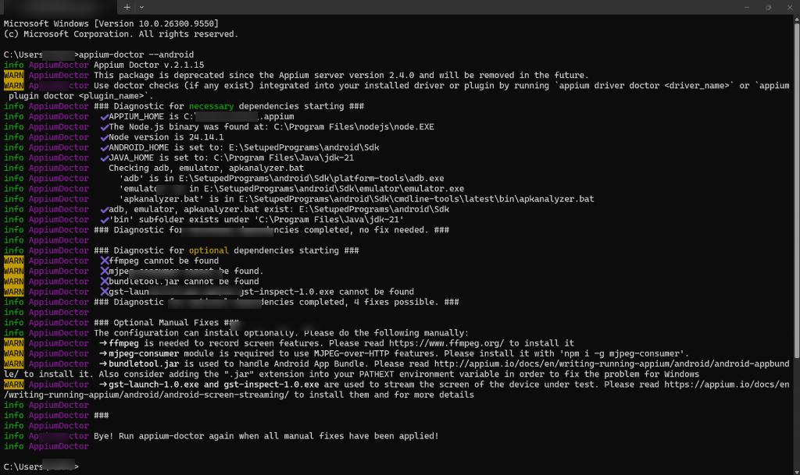
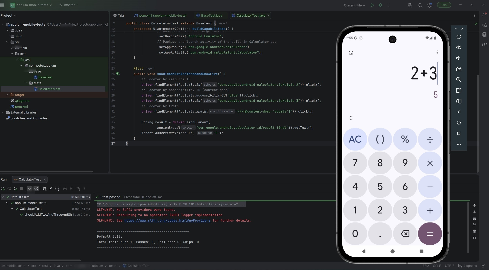
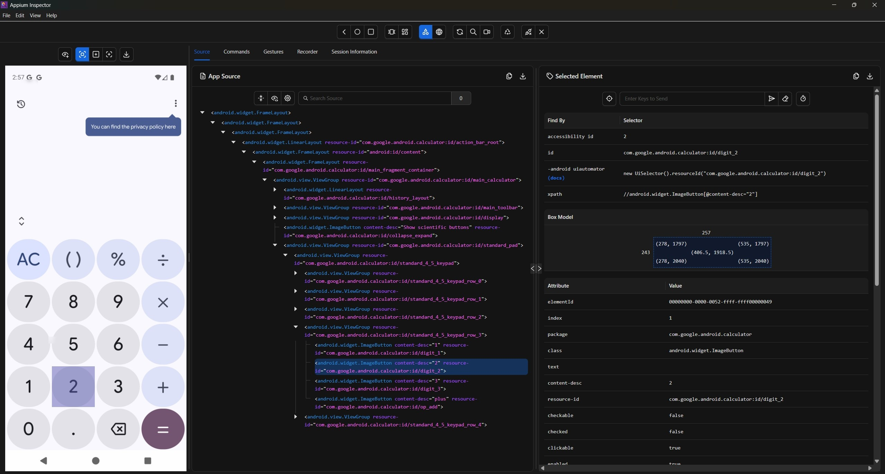
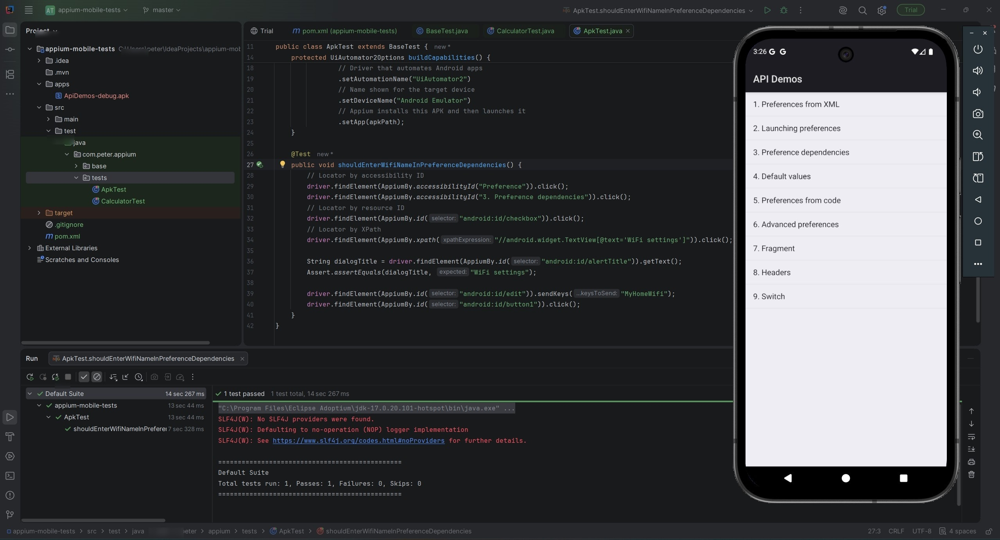
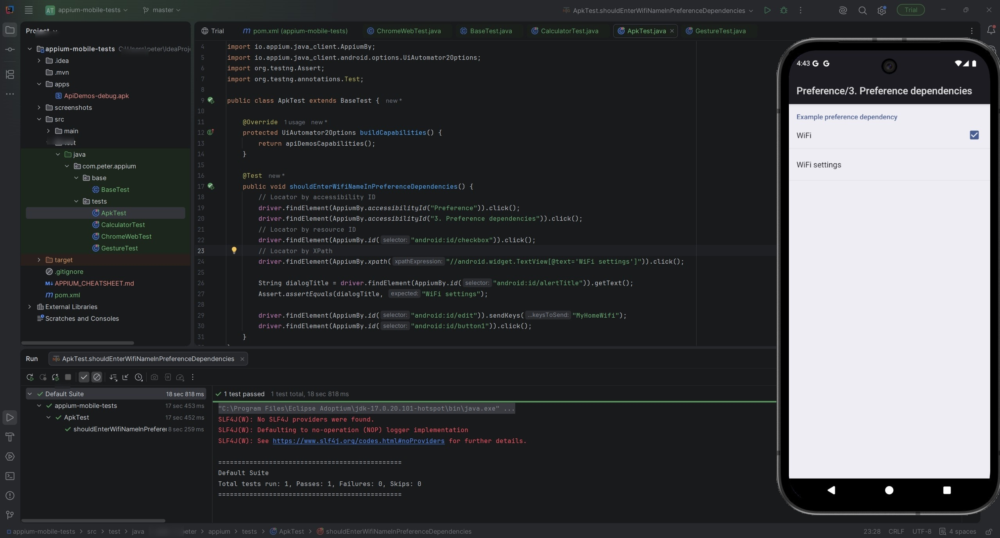
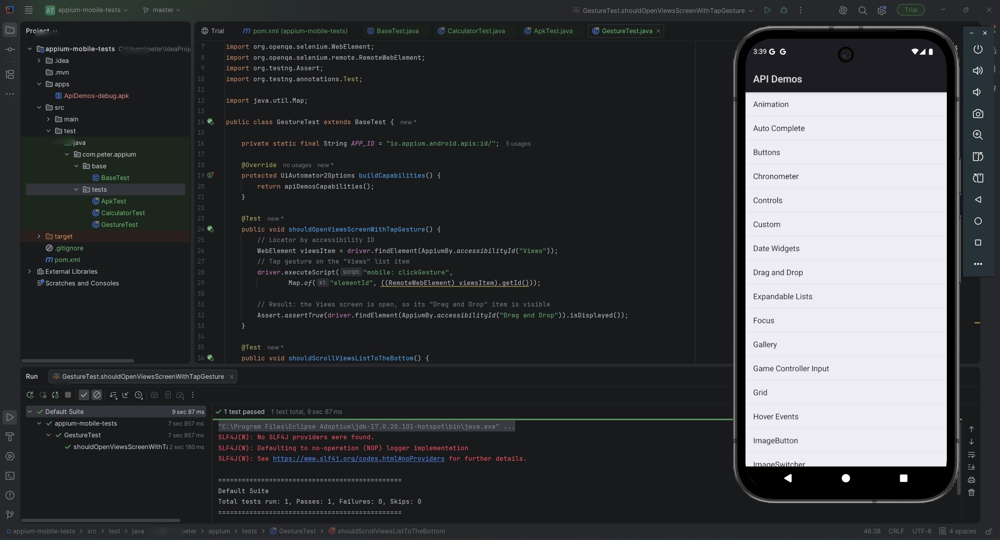
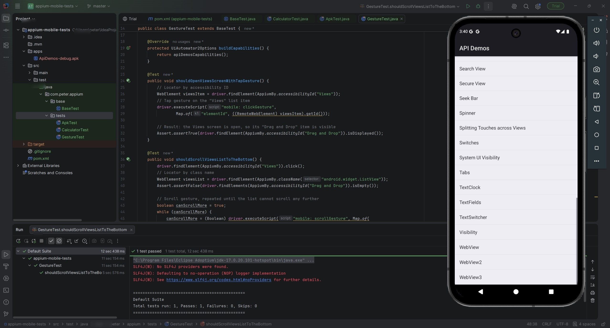
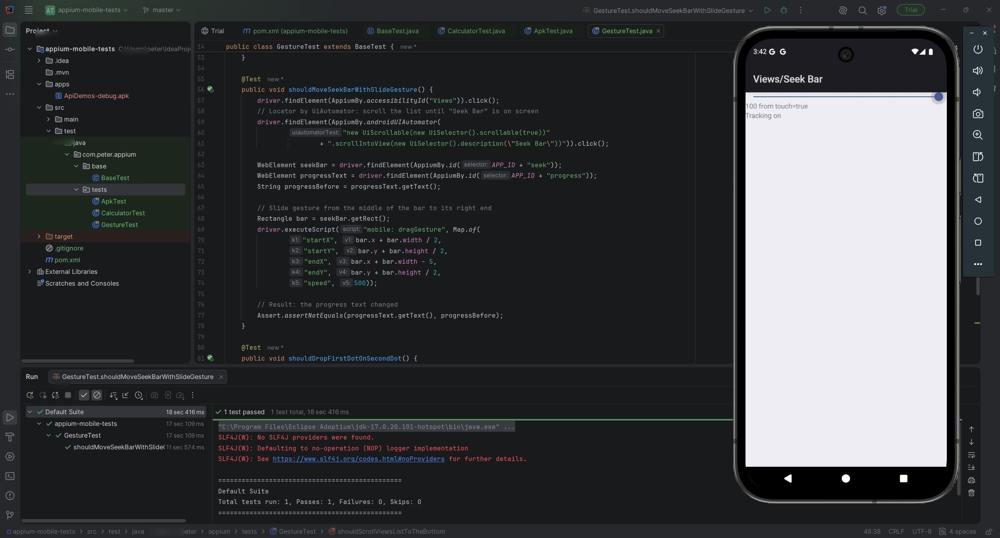
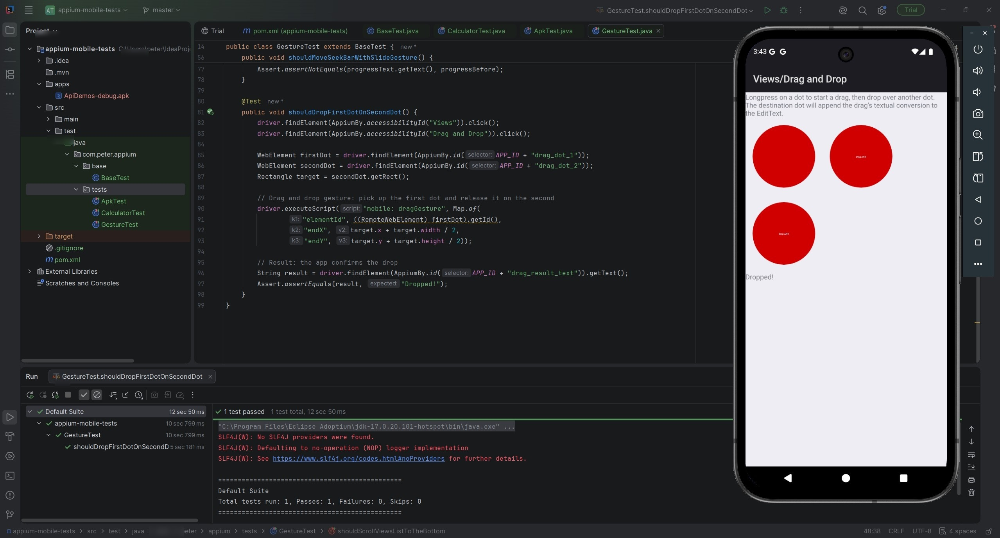
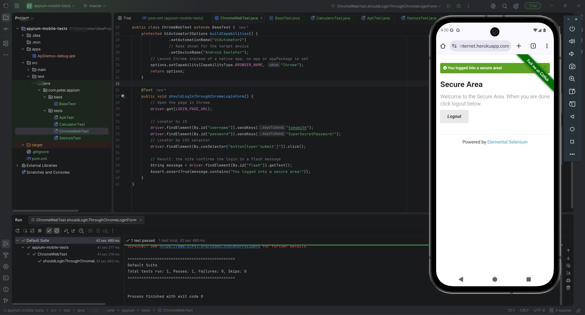

# Mobile Testing Automation with Appium — Mini Task

A comprehensive mobile automation testing framework built using **Appium 2.x**, **Java Client 10.x**, and **TestNG** targeting Android environments (AVD Emulator & Physical Devices).

---

## 🌟 Key Features & Phases

- **Phase 1 — Environment Setup & Health Check:** Full Android automation toolchain configuration on Windows (Node.js, Appium 2.x, UiAutomator2 driver, JDK 21, and Android SDK) validated with `appium-doctor`.
- **Phase 2 — Built-in App & Real APK Automation:** Automated end-to-end scenarios against the native Google Calculator and a standalone APK (`ApiDemos-debug.apk`) using element identification via ID, Accessibility ID, and XPath.
- **Phase 3 — Real Device & Gesture Automation:** Physical device test execution via USB Debugging and custom implementation of all four fundamental mobile gestures: **Tap**, **Scroll**, **Slide (Seek Bar)**, and **Drag & Drop** via the W3C Actions API.
- **Phase 4 — Mobile Web Testing on Chrome:** Automated mobile web browsing with Google Chrome on Android, validating search queries and capturing verification screenshots.
- **Phase 5 — Full Appium Java API Cheat Sheet:** Quick-reference technical documentation covering capabilities, locators, driver commands, gesture patterns, and web setups.

---

## 🏛️ Project Architecture & Design Patterns

The automation suite follows clean design principles with a centralized base test class for driver lifecycle management to eliminate duplication across test suites.

```text
appium-mobile-tests/
├── apps/                                     # Target APK files under test
│   └── ApiDemos-debug.apk
├── screenshots/                              # Phase verification screenshots
│   ├── phase1-appium-doctor.jpg
│   ├── phase2-1-calculator-test-passed.jpg
│   ├── phase2-2-inspector-calculator-locators.jpg
│   ├── phase2-3-apk-test-passed.jpg
│   ├── phase3-1-real-device-test.jpg
│   ├── phase3-2-gesture-tap.jpg
│   ├── phase3-3-gesture-scroll.jpg
│   ├── phase3-4-gesture-slide.jpg
│   ├── phase3-5-gesture-drag-and-drop.jpg
│   └── phase4-chrome-web-test.jpg
├── src/test/java/com/fakhr/appium/
│   ├── base/
│   │   └── BaseTest.java                     # Reusable driver initialization & teardown
│   └── tests/
│       ├── CalculatorTest.java               # Built-in app test suite
│       ├── ApkTest.java                      # Real APK test suite
│       ├── GestureTest.java                  # Tap, Scroll, Slide & Drag/Drop gestures
│       └── ChromeWebTest.java                # Mobile Chrome web automation
├── pom.xml                                   # Maven dependencies and build settings
├── APPIUM_CHEATSHEET.md                      # Comprehensive Appium Java reference guide
└── README.md                                 # Documentation & setup walkthrough
```

### Applied Automation Practices
- **Base Test Inheritance:** `BaseTest` manages driver instantiation, implicit waits, and clean teardowns via `@BeforeMethod` and `@AfterMethod`.
- **Typed Options (`UiAutomator2Options`):** Modern Appium 2.x options configuration replacing legacy `DesiredCapabilities`.
- **W3C Actions API:** Native touchscreen gesture simulations without deprecated TouchAction helpers.

---

## 🛠️ Tech Stack & Dependencies

| Tool / Library | Purpose |
| :--- | :--- |
| `Appium Server 2.x` | Mobile automation orchestration server |
| `UiAutomator2 Driver` | Native Android automation engine |
| `Appium Java Client 10.x` | Java bindings and mobile locators |
| `Selenium Java` | Underlying WebDriver core API |
| `TestNG` | Test execution, assertions, and lifecycle annotations |
| `Android SDK & Platform Tools` | Android emulator and ADB device bridging |
| `Maven` | Dependency management and build lifecycle |

---

## 🚀 Getting Started

1. **Clone the repository:**
   ```bash
   git clone https://github.com/FakhrElddin/appium-mobile-tests.git
   cd appium-mobile-tests
   ```

2. **Environment Variables Configuration:**
   Ensure the following environment variables are configured on Windows:
   - `JAVA_HOME` pointing to your JDK 17/21 installation.
   - `ANDROID_HOME` pointing to your Android SDK directory (e.g. `E:\SetupedPrograms\android\Sdk`).
   - Add `%ANDROID_HOME%\platform-tools` and `%ANDROID_HOME%\cmdline-tools\latest\bin` to your `PATH`.

3. **Verify Environment Setup:**
   ```bash
   appium-doctor --android
   ```

4. **Start Appium Server:**
   ```bash
   appium --allow-insecure=uiautomator2:chromedriver_autodownload
   ```

5. **Run the Automated Tests:**
   Execute all test classes or target specific suites via Maven:
   ```bash
   mvn test -Dtest=CalculatorTest
   mvn test -Dtest=ApkTest
   mvn test -Dtest=GestureTest
   mvn test -Dtest=ChromeWebTest
   ```

---

## 📸 Screenshots

### 1. Environment Verification

| Appium Doctor Android Diagnostic |
| :---: |
|  |

---

### 2. Built-in App & APK Automation (Emulator)

| Calculator Test Passed | Appium Inspector Locators | Real APK Test Passed |
| :---: | :---: | :---: |
|  |  |  |

---

### 3. Real Device & Mobile Gestures

| Real Device Test Execution | Tap Gesture | Scroll Gesture |
| :---: | :---: | :---: |
|  |  |  |

| Slide / Seek Bar Gesture | Drag & Drop Gesture |
| :---: | :---: |
|  |  |

---

### 4. Chrome Mobile Web Testing

| Chrome Browser Web Automation |
| :---: |
|  |

---

## 📖 Appium Cheat Sheet

A complete developer reference guide covering locator strategies, driver commands, and gesture snippets is available in [APPIUM_CHEATSHEET.md](APPIUM_CHEATSHEET.md).

---

## 👤 Author

**FakhrElddin**  
GitHub: [@FakhrElddin](https://github.com/FakhrElddin)